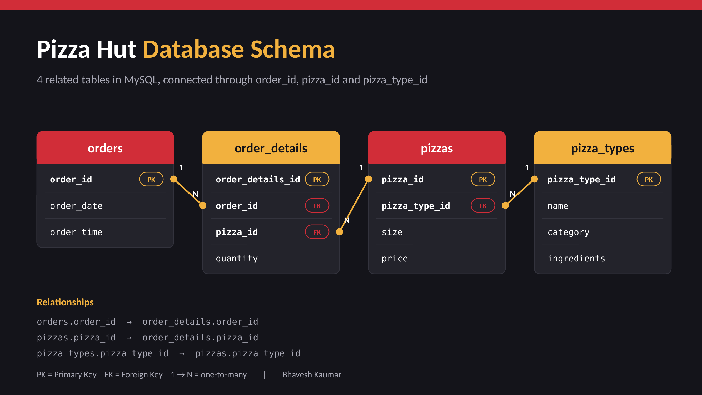

# 🍕 Pizza Hut Sales Analysis | SQL Project

An end-to-end SQL project that turns raw pizza order data into business insights using **MySQL**. It covers basic aggregations, joins across four tables, subqueries, CTEs and window functions.


---

## 📌 Project Overview

The goal of this project is to answer real business questions for a pizza chain:

- How many orders were placed and how much revenue was generated?
- Which pizzas and sizes sell the most?
- At what hours do customers order?
- Which categories and pizza types drive revenue?

Questions are grouped into **Basic**, **Intermediate** and **Advanced** levels.

---

## 🗂️ Database Schema



---

## ❓ Questions Answered

### 🟢 Basic
1. Retrieve the total number of orders placed.
2. Calculate the total revenue generated from pizza sales.
3. Identify the highest-priced pizza.
4. Identify the most common pizza size ordered.
5. List the top 5 most ordered pizza types along with their quantities.

### 🟡 Intermediate
6. Find the total quantity of each pizza category ordered.
7. Determine the distribution of orders by hour of the day.
8. Find the category-wise distribution of pizzas.
9. Calculate the average number of pizzas ordered per day.
10. Determine the top 3 most ordered pizza types based on revenue.

### 🔴 Advanced
11. Calculate the percentage contribution of each pizza category to total revenue.
12. Analyse the cumulative revenue generated over time.
13. Determine the top 3 pizza types by revenue for each pizza category.

---

## 🛠️ SQL Concepts Used

- `JOIN` across multiple tables
- `GROUP BY`, `ORDER BY`, `LIMIT`
- Aggregate functions: `SUM`, `COUNT`, `AVG`, `ROUND`
- Date and time functions: `HOUR()`
- Subqueries
- Common Table Expressions (CTEs)
- Window functions: `SUM() OVER`, `ROW_NUMBER() OVER (PARTITION BY ...)`, `RANK()`

---

## 💡 Sample Query: Top 3 Pizzas by Revenue in Each Category

```sql
WITH pizza_revenue AS (
    SELECT
        pt.category,
        pt.name,
        SUM(od.quantity * p.price) AS total_revenue
    FROM pizza_types AS pt
    JOIN pizzas AS p
        ON p.pizza_type_id = pt.pizza_type_id
    JOIN order_details AS od
        ON od.pizza_id = p.pizza_id
    GROUP BY pt.category, pt.pizza_type_id, pt.name
),
ranked_pizzas AS (
    SELECT
        category,
        name,
        total_revenue,
        ROW_NUMBER() OVER (
            PARTITION BY category
            ORDER BY total_revenue DESC
        ) AS revenue_rank
    FROM pizza_revenue
)
SELECT category, name, total_revenue
FROM ranked_pizzas
WHERE revenue_rank <= 3
ORDER BY category, revenue_rank;
```

---

## 📁 Repository Structure

```
Pizza-sales---SQL---Project/
├── README.md
├── Pizza_Hut_Queries.sql      # All SQL queries (basic to advanced)
├── data/                      # CSV files: orders, order_details, pizzas, pizza_types
└── images/                    # Schema diagram and project visuals
```

---

## 🚀 How to Run

1. Install **MySQL** and **MySQL Workbench**.
2. Create the database and tables:
   ```sql
   CREATE DATABASE Pizza_Hut;
   USE Pizza_Hut;
   ```
3. Import the CSV files into the four tables (use the *Table Data Import Wizard* in Workbench).
4. Open `Pizza_Hut_Queries.sql` and run the queries one by one.

---

## 📊 Key Insights

> Add your own findings here after running the queries, for example:
> - Total orders and revenue: ...
> - Best-selling pizza: ...
> - Peak ordering hour: ...
> - Highest-revenue category: ...

---

## 👤 Author

**Bhavesh Kaumar**

- LinkedIn: [bhavesh-kumar](https://www.linkedin.com/in/bhavesh-kumar-768890393/)
- GitHub: [Bhavesh-code1](https://github.com/Bhavesh-code1)

⭐ If you found this project useful, please give it a star!
